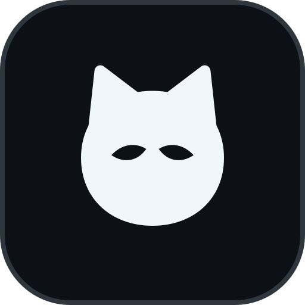

<div align="center">



# PosIssue

**No GitHub account? Anyone can file an issue.**

Add one line to your site or app, and bug reports and feature requests from your users<br>
arrive in your open-source repository as GitHub issues.

[](https://github.com/ninjin0802/posissue/releases)
[](https://github.com/ninjin0802/posissue/actions/workflows/ci.yml)
[](https://www.npmjs.com/package/posissue)
[](LICENSE)

**[🌐 posissue.2nj.lol](https://posissue.2nj.lol/?lang=en)** · [Install the GitHub App](https://github.com/apps/posissue/installations/new) · [Dashboard](https://posissue.2nj.lol/admin) · [Changelog](https://posissue.2nj.lol/en/changelog) · [日本語](README.md)

</div>

---

## Features

- 🙋 **No account needed** — reporters don’t need GitHub, and no personal data is collected.
- 🧩 **One-line setup** — a `<script>` tag on websites, or a URL opened in an app WebView.
- 📐 **Typed forms** — one `FormTemplate` defines the UI, validation and issue body.
- 🛡️ **Spam protection** — Turnstile, honeypot, rate limits, duplicate detection, neutralized @mentions.
- ✅ **Approval mode** — review reports before they become issues (on by default for public repositories).
- 🗂️ **Dashboard** — keys, allowed sites, daily limits, approval mode and pending reports.
- 🌗 **A beautiful form** — automatic light/dark and a Japanese/English switch.
- 🤖 **AI-friendly** — [`/llms.txt`](https://posissue.2nj.lol/llms.txt) and a CLI for coding agents.

## Getting started

1. Install the [GitHub App](https://github.com/apps/posissue/installations/new) on your repository. You get a project key (`pk_...`).
2. Add the widget:

```html
<script src="https://posissue.2nj.lol/widget.js" data-key="pk_xxx" data-lang="en" async></script>
```

   Or with npm: `npm i posissue` then `import { init } from "posissue"; init({ projectKey: "pk_xxx" });`

   In apps, open `https://posissue.2nj.lol/r/pk_xxx?lang=en&app_version=1.2.0&os=ios` in a WebView.

3. Reports arrive as issues labeled `via-widget` (in approval mode, after you click “Publish” in the dashboard).

Find your keys any time at **[posissue.2nj.lol/admin](https://posissue.2nj.lol/admin)** or with the CLI (Node 18+):

```sh
npx posissue keys --json
```

The CLI prints a GitHub URL and a one-time code. **You sign in to GitHub yourself in the browser.**

## Ask an AI to add it

```text
Read https://posissue.2nj.lol/llms.txt and add the PosIssue feedback widget to this project.
```

## Self-hosting

```sh
npm i @posissue/server
```

```ts
import { createHandler, type FormTemplate } from "@posissue/server";
export default createHandler({ forms: [/* FormTemplate[] */] });
```

See the spec (`docs/spec/`, Japanese) for deployment. The spec is the single source of truth.

## Notes

- With a strict CSP, add `https://posissue.2nj.lol` to `script-src` and `frame-src`.
- Replies to reporters and screenshot attachments are not supported yet.

## Author

**ninjin** — an indie developer who builds whatever catches their interest. [GitHub](https://github.com/ninjin0802) · [2nj.lol](https://2nj.lol)

## License

MIT. See the hosted service’s [Privacy Policy](https://posissue.2nj.lol/en/privacy) and [Terms](https://posissue.2nj.lol/en/terms).
