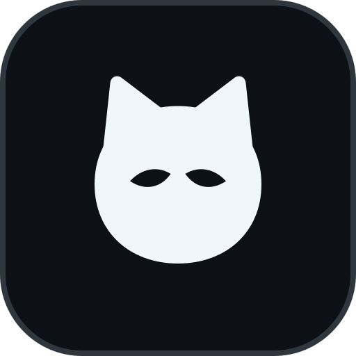
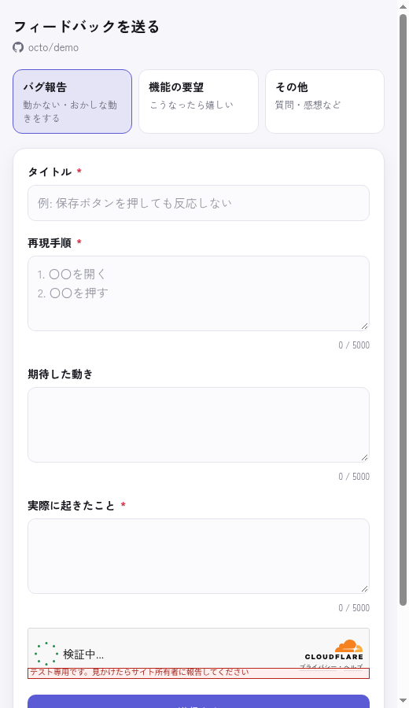
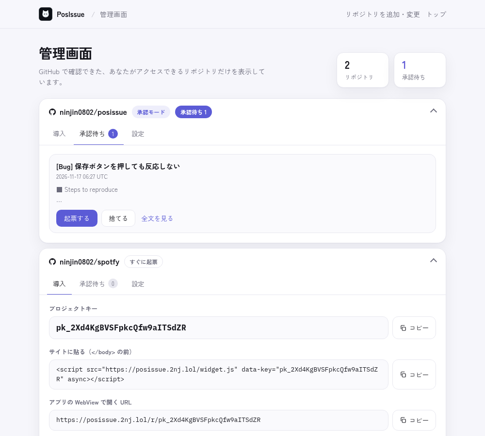
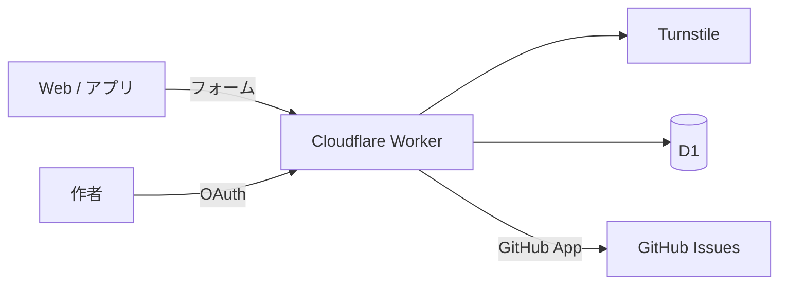

<div align="center">



# PosIssue

**GitHub アカウントがなくても、だれでも Issue を送れる。**

サイトやアプリにウィジェットを 1 行置くだけで、利用者からのバグ報告や要望が<br>
あなたの OSS リポジトリに GitHub Issue として届きます。

[](https://github.com/ninjin0802/posissue/releases)
[](https://github.com/ninjin0802/posissue/actions/workflows/ci.yml)
[](https://www.npmjs.com/package/posissue)
[](LICENSE)


**[🌐 posissue.2nj.lol](https://posissue.2nj.lol)** · [GitHub App をインストール](https://github.com/apps/posissue/installations/new) · [管理画面](https://posissue.2nj.lol/admin) · [リリースノート](CHANGELOG.md) · [English](README.en.md)

<br>

<picture>
  <source media="(prefers-color-scheme: dark)" srcset="docs/images/form-dark.png">
  
</picture>

</div>

---

## ✨ 特長

| | |
|---|---|
| 🙋 **アカウント不要** | 報告する人は GitHub に登録しなくても送れます。個人情報も集めません |
| 🧩 **1 行で導入** | `<script>` を貼るか `init()` を呼ぶだけ。アプリなら WebView で URL を開くだけ |
| 📐 **フォームは型で決まる** | `FormTemplate` を渡すと、画面・入力チェック・Issue 本文の形がそろって決まります |
| 🛡️ **スパム対策が最初から** | Turnstile、ハニーポット、投稿数の制限、重複検出、@メンションの無効化 |
| ✅ **承認モード** | 届いた報告を確認してから Issue にできます。公開リポジトリでは最初からオン |
| 🗂️ **管理画面** | キーの確認、埋め込みを許すサイト・1 日の上限・承認モードの設定、承認待ちの処理 |
| 🌗 **きれいなフォーム** | ライト / ダーク自動切替、日本語 / English 切り替え、アクセシビリティに配慮 |
| 🤖 **AI に頼める** | [`/llms.txt`](https://posissue.2nj.lol/llms.txt) と CLI で、AI コーディングエージェントが導入できます |
| ☁️ **Cloudflare で完結** | Workers + D1 + Turnstile。無料枠から始められ、セルフホストもできます |

## 🚀 はじめかた

### 1. GitHub App をインストール

[GitHub App](https://github.com/apps/posissue/installations/new) をリポジトリにインストールすると、`projectKey`（`pk_...`）が発行され、そのまま管理画面が開きます。

### 2. ウィジェットを置く

<table>
<tr><th>Web サイト</th><th>npm（React / Vue / Next.js など）</th></tr>
<tr><td>

```html
<script
  src="https://posissue.2nj.lol/widget.js"
  data-key="pk_xxx"
  async></script>
```

</td><td>

```sh
npm i posissue
```

```ts
import { init } from "posissue";
init({ projectKey: "pk_xxx", lang: "ja" });
```

</td></tr>
</table>

**アプリ（iOS / Android / Flutter / Electron など）** は、次の URL を WebView かブラウザで開くだけです。

```text
https://posissue.2nj.lol/r/pk_xxx?lang=ja&app_version=1.2.0&os=ios
```

`<script>` には `data-lang="ja|en"`、`data-position="bottom-right|bottom-left"`、`data-label="フィードバック"`、`data-kinds="bug,feature,other"` を付けられます。アプリの URL のクエリ（`lang`・`kinds` 以外）は、環境情報として Issue に載ります。

### 3. Issue が届く

送られた報告は `via-widget` ラベル付きの Issue になります（承認モードのときは、管理画面で「起票する」を押したときに作られます）。

```markdown
[Bug] 保存ボタンを押しても反応しない

### Steps to reproduce
1. 設定を開く
2. 保存を押す

### What happened
何も起きない

<details><summary>Environment</summary> page / userAgent / appVersion ... </details>
```

## 🗂️ 管理画面

**[posissue.2nj.lol/admin](https://posissue.2nj.lol/admin)**（トップページ右上のアイコン）を開いて GitHub でログインすると、あなたがアクセスできるリポジトリだけが表示されます。



<sub>画面の例（承認待ちは見本です）。左の一覧でリポジトリを選ぶと、右にそのリポジトリの導入・承認待ち・設定が出ます。</sub>

| タブ | できること |
|---|---|
| 導入 | プロジェクトキー、サイトに貼るコード、アプリ用の URL をコピー |
| 承認待ち | 届いた報告を 1 件ずつ「起票する」「捨てる」（14 日で自動削除） |
| 設定 | 届いた報告の扱い（承認してから起票 / すぐに起票）、埋め込みを許すサイト（最大 10）、1 日の上限（1〜1000） |

設定と承認ができるのは、そのリポジトリの管理者（admin / maintain）だけです。左の一覧は、検索と絞り込み（承認待ち・承認モード・すぐに起票）ができ、承認待ちの多い順に並びます。

ターミナルからもキーを確認できます（Node 18+）。表示された URL とコードで、ブラウザから GitHub にログインしてください。

```sh
npx posissue keys          # 一覧
npx posissue keys --json   # JSON（スクリプトや AI 向け）
```

## 🤖 AI に導入してもらう

Claude Code や Cursor などの AI に、次のように頼むだけで導入できます。

```text
https://posissue.2nj.lol/llms.txt を読んで、このプロジェクトに PosIssue のフィードバックウィジェットを入れて。
```

AI はキーを取るときに CLI を実行し、表示された URL とコードをあなたに渡します。**GitHub へのログインは、あなた自身がブラウザで行います。** このリポジトリ自体を AI で開発するときのルールは [`AGENTS.md`](AGENTS.md) にあります。

## 📐 フォームを型で決める（セルフホスト）

```sh
npm i @posissue/server
```

フォームの項目は `FormTemplate` で決めます。書き間違えるとエディタが教えてくれて、起動時にもチェックされます。

```ts
import { createHandler, type FormTemplate } from "@posissue/server";

const forms: FormTemplate[] = [
  {
    kind: "bug",
    label: { en: "Bug", ja: "バグ報告" },
    fields: [
      { id: "steps", type: "textarea", required: true, label: { en: "Steps", ja: "再現手順" } },
      { id: "severity", type: "select", label: { en: "Severity", ja: "深刻度" },
        options: [{ value: "low", label: "Low" }, { value: "high", label: "High" }] },
    ],
  },
];

export default createHandler({ forms });
```

使える項目の種類は `text` / `textarea` / `select` / `checkbox` です。公式ホストでは標準の型（バグ報告・機能の要望・その他）を使います。セルフホストの手順は[仕様書の 9 章](docs/spec/09-operations.html)を見てください。

## 🛡️ スパム対策と安全性

安い検査から順に行い、どれかに引っかかった時点で止めます。

```
入力チェック → ハニーポット → 送信速度 → URL の数 → プロジェクト確認
  → 埋め込み元 → IP ごとの制限 → Turnstile → 1 日の上限 → 重複検出 → （承認待ち）→ Issue 作成
```

- 本文の `@メンション` と `#123` は無効にしてから Issue にするので、通知を悪用されません。環境情報の欄はリンクになりません。
- 管理画面とキーの確認は GitHub の OAuth で本人確認し、アクセスできるリポジトリだけを表示します（state のクッキー照合でログイン CSRF も防ぎます）。
- 報告者の IP・メールアドレス・GitHub アカウントは保存しません。詳しくは[プライバシーポリシー](https://posissue.2nj.lol/privacy)を見てください。

## 🏗️ 構成

```
packages/
  core/     @posissue/core    型・検証・Issue 本文の組み立て（npm）
  server/   @posissue/server  Cloudflare Workers 用ハンドラ（フォーム・API・管理画面・OAuth）（npm）
  widget/   posissue          ブラウザ用ウィジェットと CLI（npm）
apps/
  hosted/                     公式ホスト（wrangler 設定・D1 マイグレーション・静的ページ）
cli/        posissue keys     キー確認用の CLI（npm の posissue に同梱）
docs/spec/                    仕様書（SSOT）
```



## 📖 仕様書

[`docs/spec/`](docs/spec/index.html) が唯一の正（SSOT）です。実装を変えるときは先に仕様書を更新します。リポジトリを clone して `docs/spec/index.html` をブラウザで開くと、章ごとのサイドメニュー付きで読めます。

## 🧑‍💻 開発

```sh
npm install
npm test            # vitest
npm run typecheck   # tsc
cd apps/hosted && npx wrangler dev
```

main には直接 push せず、ブランチ → PR → CI（型チェック・テスト）が通ってからマージします。

## ⚠️ 注意

- 厳しい CSP のサイトでは、`script-src` と `frame-src` に `https://posissue.2nj.lol` を追加してください。
- まだ、報告した人への返信とスクリーンショットの添付はできません（[ロードマップ](docs/spec/10-roadmap.html)）。

## 📝 リリースノート

[CHANGELOG.md](CHANGELOG.md)・[ホームページ版](https://posissue.2nj.lol/changelog)・[GitHub Releases](https://github.com/ninjin0802/posissue/releases)

## 👤 作った人

**ninjin** — 個人開発者です。Web アプリ、Android アプリ、プログラミング言語まで、気になったものは作って確かめています。
[GitHub](https://github.com/ninjin0802) · [2nj.lol](https://2nj.lol)

## 📄 ライセンス・規約

公式ホストの[プライバシーポリシー](https://posissue.2nj.lol/privacy)・[利用規約](https://posissue.2nj.lol/terms)。ソースコードは [MIT](LICENSE) ライセンスです。
