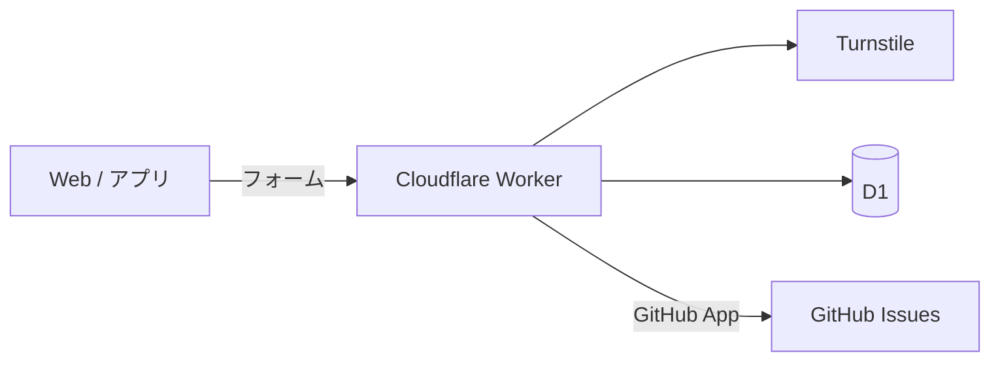

<div align="center">


# PosIssue

**GitHub アカウントがなくても、だれでも Issue を送れる。**

サイトやアプリにウィジェットを 1 行置くだけで、利用者からのバグ報告や要望が<br>
あなたの OSS リポジトリに GitHub Issue として届きます。

[](LICENSE)


**[🌐 posissue.2nj.lol](https://posissue.2nj.lol)** · [GitHub App をインストール](https://github.com/apps/posissue/installations/new) · [仕様書](docs/spec/index.html)

<br>

<picture>
  <source media="(prefers-color-scheme: dark)" srcset="docs/images/form-dark.png">
  
</picture>

</div>

---

## ✨ 特長

| | |
|---|---|
| 🙋 **アカウント不要** | 報告する人は GitHub に登録しなくても送れます |
| 🧩 **1 行で導入** | `<script>` を貼るか `init()` を呼ぶだけ。アプリなら WebView で URL を開くだけ |
| 📐 **フォームは型で決まる** | `FormTemplate` を渡すと、画面・入力チェック・Issue 本文の形がそろって決まります |
| 🛡️ **スパム対策が最初から** | Turnstile、ハニーポット、投稿数の制限、重複検出、@メンションの無効化 |
| 🌗 **きれいなフォーム** | ライト/ダーク自動切替、日本語・英語対応、アクセシビリティに配慮 |
| ☁️ **Cloudflare で完結** | Workers + D1 + Turnstile。無料枠から始められます |

## 🚀 はじめかた

### 1. GitHub App をインストール

[公式ホスト](https://posissue.2nj.lol)の [GitHub App](https://github.com/apps/posissue/installations/new) をリポジトリにインストールすると、`projectKey`（`pk_...`）が発行されます。あとから確認したいときは **[管理画面](https://posissue.2nj.lol/admin)**（トップページ右上の「管理画面」）を開き、GitHub でログインするだけです。キーと貼り付け用コードの確認、設定（埋め込みを許すサイト・1 日の上限・承認モード）の変更、承認待ちの報告の処理ができます。

ターミナルからも確認できます（Node 18+）。表示された URL とコードでブラウザからログインすると、キーが出ます。

```sh
npx github:ninjin0802/posissue keys          # 一覧
npx github:ninjin0802/posissue keys --json   # JSON（スクリプトや AI 向け）
```

### 2. ウィジェットを置く

<table>
<tr><th>Web サイト</th><th>npm</th></tr>
<tr><td>

```html
<script
  src="https://posissue.2nj.lol/widget.js"
  data-key="pk_xxx"
  async></script>
```

</td><td>

```ts
import { init } from "posissue";

init({
  projectKey: "pk_xxx",
  meta: { appVersion: "1.2.0" },
});
```

</td></tr>
</table>

**アプリ（iOS / Android / Flutter / Electron など）** は、次の URL を WebView で開くだけです。

```
https://posissue.2nj.lol/r/pk_xxx?app_version=1.2.0&os=ios
```

### 3. Issue が届く

送られた報告は `via-widget` ラベル付きの Issue になります。

```markdown
[Bug] 保存ボタンを押しても反応しない

### Steps to reproduce
1. 設定を開く
2. 保存を押す

### What happened
何も起きない

<details><summary>Environment</summary> page / userAgent / appVersion ... </details>
```

## 🤖 AI に導入してもらう

Claude Code や Cursor などの AI に、次のように頼むだけで導入できます。AI 向けの手順は [`/llms.txt`](https://posissue.2nj.lol/llms.txt) にまとめてあります。

```text
https://posissue.2nj.lol/llms.txt を読んで、このプロジェクトに PosIssue のフィードバックウィジェットを入れて。
projectKey は pk_xxxxxxxxxxxxxxxxxxxxxxxx。
```

このリポジトリ自体を AI で開発するときのルールは [`AGENTS.md`](AGENTS.md) にあります。

## 📐 フォームを型で決める

フォームの項目は `FormTemplate` で決めます。書き間違えるとエディタが教えてくれて、起動時にもチェックされます。

```ts
import { createHandler, type FormTemplate } from "@posissue/server";

const forms: FormTemplate[] = [
  {
    kind: "bug",
    label: { en: "Bug", ja: "バグ報告" },
    fields: [
      { id: "steps", type: "textarea", required: true, label: { en: "Steps", ja: "再現手順" } },
      { id: "severity", type: "select", label: { en: "Severity", ja: "深刻度" },
        options: [{ value: "low", label: "Low" }, { value: "high", label: "High" }] },
    ],
  },
];

export default createHandler({ forms });
```

使える項目の種類は `text` / `textarea` / `select` / `checkbox` です。

## 🛡️ スパム対策

安い検査から順に行い、どれかに引っかかった時点で止めます。

```
入力チェック → ハニーポット → 送信速度 → URL の数 → プロジェクト確認
  → 埋め込み元 → IP ごとの制限 → Turnstile → 1 日の上限 → 重複検出 → Issue 作成
```

本文の `@メンション` と `#123` は無効にしてから Issue にするので、通知を悪用されません。

## 🏗️ 構成

```
packages/
  core/     @posissue/core    型・検証・Issue 本文の組み立て
  server/   @posissue/server  Cloudflare Workers 用ハンドラ
  widget/   posissue          ブラウザ用ウィジェット
apps/
  hosted/                     公式ホスト
docs/spec/                    仕様書（SSOT）
```



## 📖 仕様書

[`docs/spec/`](docs/spec/index.html) が唯一の正（SSOT）です。実装を変えるときは先に仕様書を更新します。リポジトリを clone して `docs/spec/index.html` をブラウザで開くと、章ごとのサイドメニュー付きで読めます。

## 🧑‍💻 開発

```sh
npm install
npm test            # vitest
npm run typecheck   # tsc
cd apps/hosted && npx wrangler dev
```

セルフホストの手順は仕様書の 9 章を見てください。

## ⚠️ 注意

- 厳しい CSP のサイトでは、`script-src` と `frame-src` に `posissue.2nj.lol` を追加してください。
- v1 では、報告した人への返信、スクリーンショットの添付、管理画面はまだありません（[ロードマップ](docs/spec/10-roadmap.html)）。

## 📝 リリースノート

[CHANGELOG.md](CHANGELOG.md)・[ホームページ版](https://posissue.2nj.lol/changelog)・[GitHub Releases](https://github.com/ninjin0802/posissue/releases)

## 📄 ライセンス・規約

公式ホストの[プライバシーポリシー](https://posissue.2nj.lol/privacy)・[利用規約](https://posissue.2nj.lol/terms)。

ソースコードは [MIT](LICENSE) ライセンスです。
